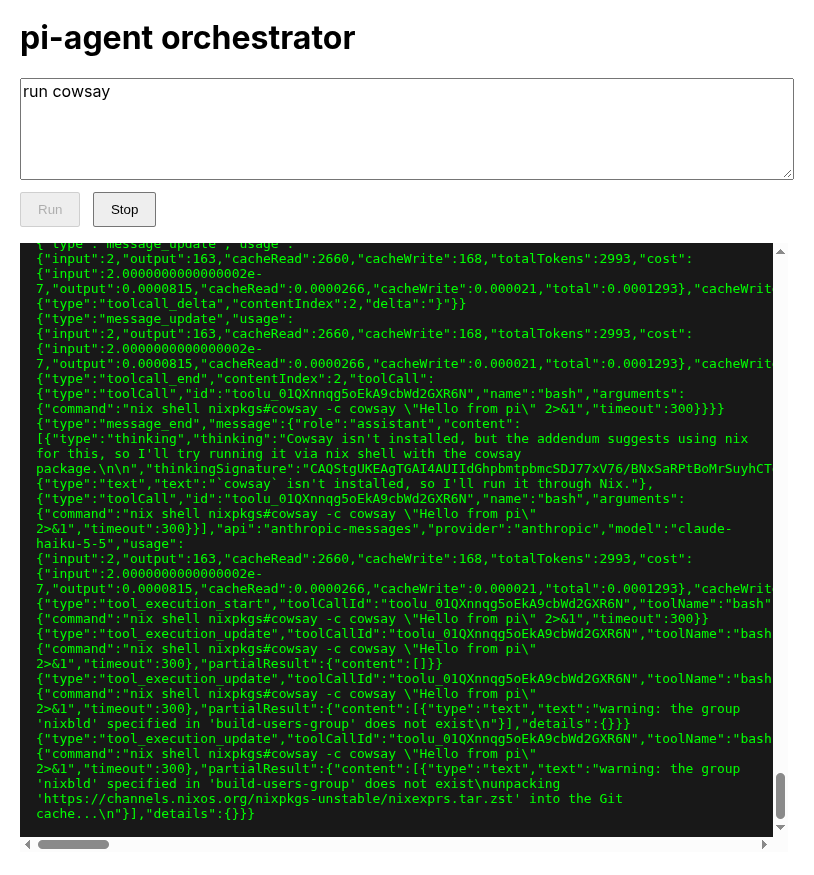

# nix-pi-agent

This is an experiment to call a pi agent running with nix as a package manager
with local cachix instance for caching derivations. This is especially potent if
you horizontally scale the nix pi agent so that packages can be rapidly fetched
from cachix.

As a test you can run `nix run .#up` (and `.#down` when done) to launch a web
server that connects to the pi agent over a websocket. From here you can check
to see if it has a packge locall cached by checking for it in it's on disk nix
store by telling it to do `ls /nix/store/*mypackage*` (e.g. cowsay). Then you
can tell it to run `cowsay` which will cause it to install and run the package.
Now you can verify that cowsay is in the nix store by telling it to run `ls
/nix/store/*cowsay*`.

